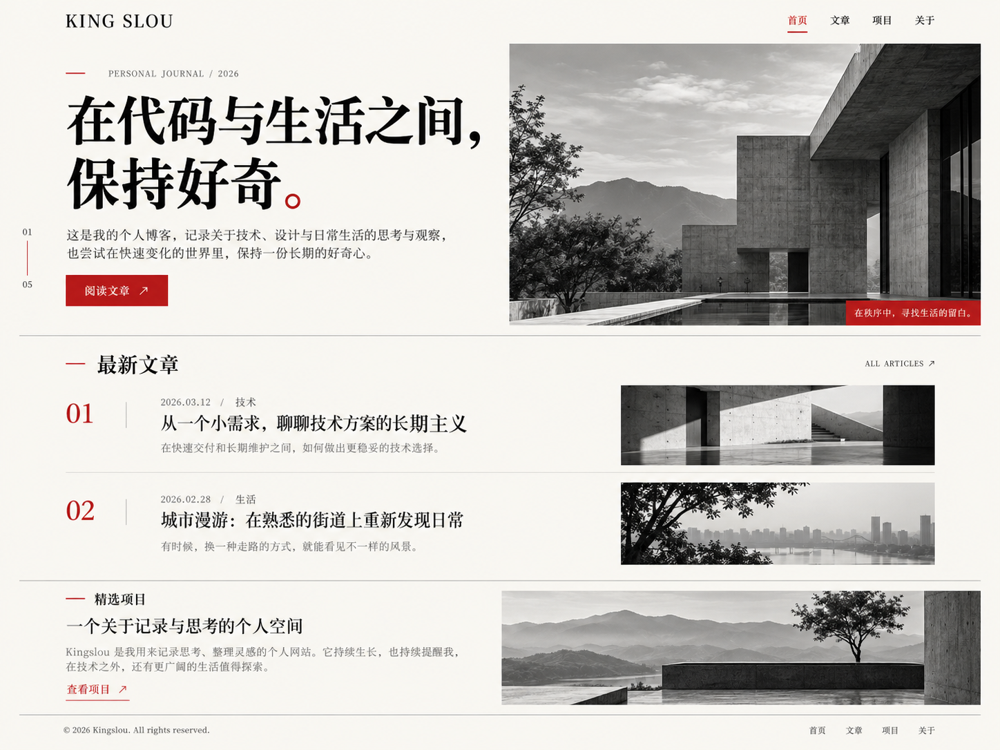
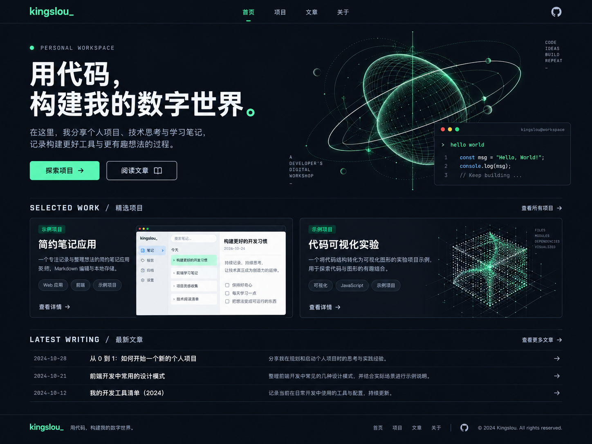
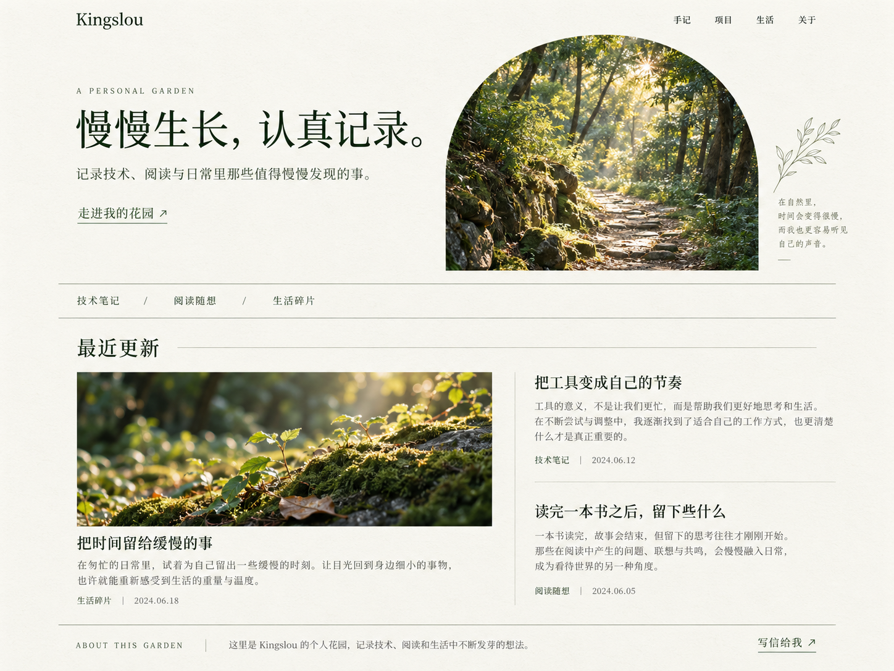
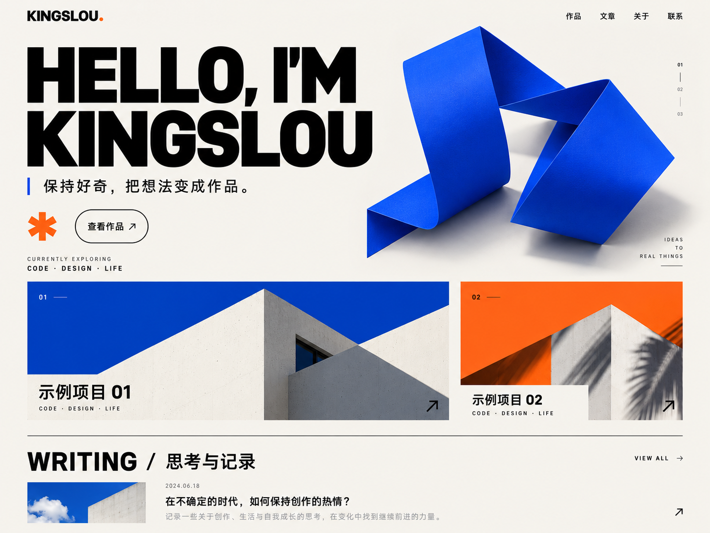
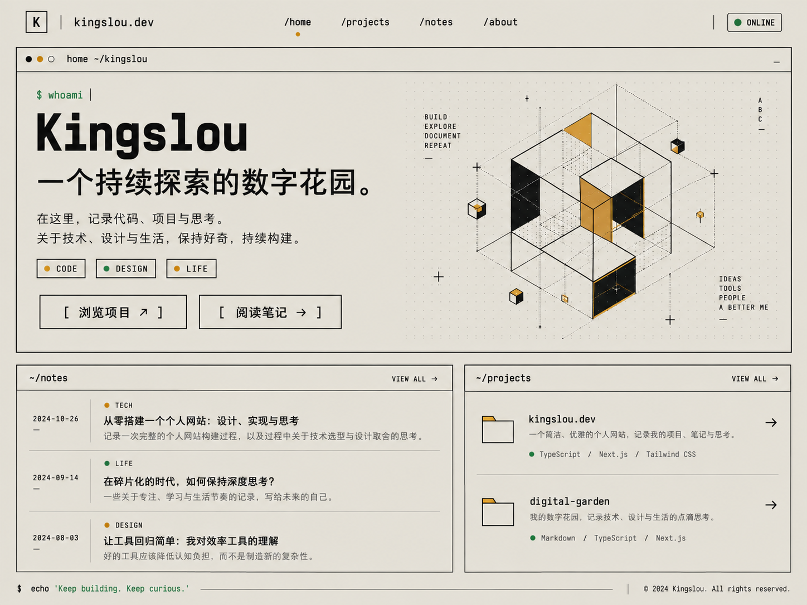

# Design exploration

## Final website asset

The selected direction was adapted to side hustles and personal growth. `../assets/architecture.png` was generated with the built-in image_gen tool using the following prompt:

Use case: photorealistic-natural. Asset type: hero photograph for a sophisticated minimalist personal journal website about side projects and independent work. Generate a single premium black and white architectural photograph, landscape 1600x1100 composition. Brutalist minimalist concrete courtyard with a shallow reflecting pool, deep rectangular portico on right, Japanese pine tree on left, hazy layers of distant mountains and soft cloudy sky. Human-scale empty contemplative architecture, strong perspective and exquisitely detailed concrete texture, refined analog monochrome photography with soft tonal range, natural daylight, peaceful editorial mood. No text, no words, no watermark, no logos, no people, no mockup or webpage. Photograph fills entire image edge-to-edge. Main architecture and mountain landscape readable when cropped to a wide banner.

Generated with the built-in image_gen tool. Concept 01 was selected; the final website topic is side hustles and personal growth. Original mockups contain illustrative placeholder copy.

## 01-editorial / 极简杂志

### Generation prompt

Use case: ui-mockup. Create one high fidelity finished desktop homepage design for a personal website and blog named Kingslou. This is concept 01, an elegant typographic editorial magazine. Deliver a single flat front-on website screenshot, 1600x1200 landscape composition, no browser chrome, no device frames, no presentation board. Warm ivory background, charcoal ink, carefully restrained vermilion accents. Extremely refined typography with large expressive serif display and crisp small sans serif labels. Wide margins, strong asymmetric editorial grid, hairline dividers, sophisticated negative space. Top navigation brand KING SLOU at left, Chinese links 首页 文章 项目 关于 at right. Hero eyebrow PERSONAL JOURNAL / 2026; enormous two-line Chinese headline 在代码与生活之间，保持好奇。 and a short intro identifying this as a personal journal about technology, design and everyday observations. CTA 阅读文章 ↗. Small side vertical index 01—05. A tasteful large landscape black-and-white architectural photograph on the right, with a small red caption tab. Below, section 最新文章 with two elegant numbered horizontal article rows, editorial dates and categories, and small photographic thumbnails. Lower edge includes selected project preview and an understated footer. Exact brand Kingslou; no invented accomplishments, ratings or statistics. Chinese text should be crisp and well typeset. The page should feel like a real premium independent magazine personal blog, implementable as HTML/CSS. Showcase both hero and substantial content beneath it, without squeezing too much. No generic dashboard cards, no gradients, no watermark.

## 02-dark-developer / 深色开发者

### Generation prompt

Use case: ui-mockup. Create a polished desktop personal developer website homepage for Kingslou, concept 02 titled midnight workshop. One flat straight-on website screenshot, 1600x1200 landscape composition, no laptop or browser chrome, no presentation board. Near-black navy background, off-white typography, electric mint green accent and muted slate secondary text. Use a modern technical grotesk typeface, selective monospace annotation, thin subtle borders and deliberate balanced spacing. Top logo kingslou_ in mint, navigation 首页 / 项目 / 文章 / 关于, small GitHub icon link. Hero left: tiny green-dot label PERSONAL WORKSPACE, large beautiful Chinese headline 用代码，构建我的数字世界。, subdued paragraph about sharing projects and technical notes, filled mint button 探索项目 and outlined button 阅读文章. Hero right: a carefully composed abstract luminous mint wireframe orbital sculpture above a small dark code panel showing a brief illustrative hello world. Below hero a SELECTED WORK / 精选项目 section featuring two wide project preview tiles, one with a minimalist web interface preview and one with an abstract code visualization. Category labels indicate 示例项目 rather than invented real achievements. Lower area is readable latest writing rows with dates, and a compact footer. Expensive developer portfolio aesthetic with credible hierarchy, no fake metrics, no excessive neon glow, no gradient background, no watermark. Chinese typography crisp, precise and intentional. Real buildable webpage layout, useful content, varied section proportions.

## 03-nature-journal / 自然手记

### Generation prompt

Use case: ui-mockup. Design one high fidelity desktop homepage screenshot of Kingslou's personal website, concept 03 a calm nature journal and digital garden. Single flat front-on screen 1600x1200 landscape, no browser chrome, no mockup device, no board. Warm cream paper background, deep forest green typography, muted olive accents, natural photographic imagery, fine paper texture extremely subtle. Top small serif wordmark Kingslou. / navigation 手记 项目 生活 关于. Hero uses an airy two-column layout: left small eyebrow A PERSONAL GARDEN, large beautifully typeset Chinese heading 慢慢生长，认真记录。, short copy about technology, reading and daily discoveries, understated green text link 走进我的花园 ↗; right a large beautiful organic rounded arch crop of a sunlit forest path with soft light, tasteful small botanical line drawing tucked near caption. Below horizontal categories 技术笔记 / 阅读随想 / 生活碎片 on a hairline divider. A section 最近更新 with one large landscape photo article at left and two stacked editorial text articles at right. Use short plausible Chinese sample article titles, show small category and date. Lower edge an ABOUT THIS GARDEN section with a short introduction and a quiet email contact link, do not invent a real email. Focus on warmth, reading comfort and rhythm, sophisticated Japanese-inspired editorial composition, not a wellness business or ecommerce site. Include legible Chinese content and large whitespace, no fake accomplishments or numbers, no watermark.

## 04-creative-portfolio / 创意作品集

### Generation prompt

Use case: ui-mockup. Create one exceptional desktop personal portfolio and blog homepage for Kingslou, concept 04 bold creative studio. Flat straight-on website screenshot, 1600x1200 landscape composition, no surrounding frame or browser, no presentation board. Off-white canvas, cobalt blue as bold primary color, vivid tangerine as small contrasting accent, black text. Asymmetric Swiss-inspired graphic layout and confident huge typography. Top left black custom typographic wordmark KINGSLOU with tiny orange dot; top right links 作品 文章 关于 联系. Hero has an oversized stacked HELLO, I'M KINGSLOU. headline occupying the left 60 percent, with a narrow cobalt vertical line and a short crisp Chinese subtitle 保持好奇，把想法变成作品。 A small orange asterisk graphic and circular outline action 查看作品 ↗. Right a striking 3D folded cobalt ribbon sculpture on neutral background, nonfigurative and very clean. Hero bottom small CURRENTLY EXPLORING / CODE · DESIGN · LIFE, no fabricated job position or client logos. Beneath an asymmetrical selected projects layout, large project image preview at left using a graphic blue and cream composition and smaller orange-accented tile on right, titles clearly 示例项目 01 and 示例项目 02. At lower edge a WRITING / 思考与记录 heading with a clean single article row. Lots of crisp contrast, precise grid, tasteful playful details, editorial quality. Avoid rounded SaaS dashboard cards, purple gradients, unreadable microtype, fake metrics, watermarks. Chinese text clean and accurate, visual design feasible to implement.

## 05-retro-terminal / 复古终端

### Generation prompt

Use case: ui-mockup. Create a premium personal website homepage design for Kingslou, concept 05 retro terminal meets a modern engineering notebook. Single flat front-on full desktop page screenshot, landscape 1600x1200 composition, no physical computer, no browser chrome or presentation board. Pale warm gray background, black monospaced typography, sharp black hairline borders, restrained amber and muted terminal green accents. Technical typography but highly readable, ample whitespace, neatly aligned two-column grid. Top bar a small outlined square K mark with kingslou.dev wordmark, navigation /home /projects /notes /about, tiny switch-like green status indicator labeled ONLINE. Main hero section outlined like an elegantly minimal terminal window with tiny title home ~/kingslou; small command $ whoami; very large heading Kingslou; prominent Chinese line 一个持续探索的数字花园。; brief Chinese copy about code, projects and thoughts. Right of hero a sophisticated original black and amber line-art isometric cube construction on a subtle dotted engineering grid, no giant ASCII wall. Include small pill tags CODE / DESIGN / LIFE. Two square-corner actions [ 浏览项目 ↗ ] and [ 阅读笔记 → ]. Below hero a clean split layout: wider left panel titled ~/notes with three readable article rows, category labels and sample dates; right panel ~/projects with two compact sample project listings, small folder icons and languages. Bottom quiet line $ echo 'Keep building. Keep curious.' and a simple footer. Authentic refined retro-web sensibility with contemporary spacing, playful but mature, no fake GitHub star counts, no fake identity details, no heavy scanline effect or neon glow, no watermark. Chinese typography crisp, stylish and legible.
